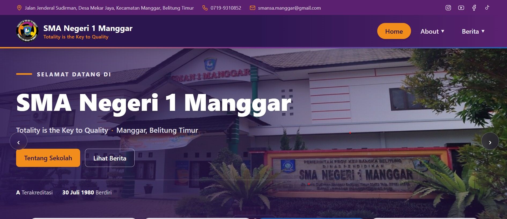
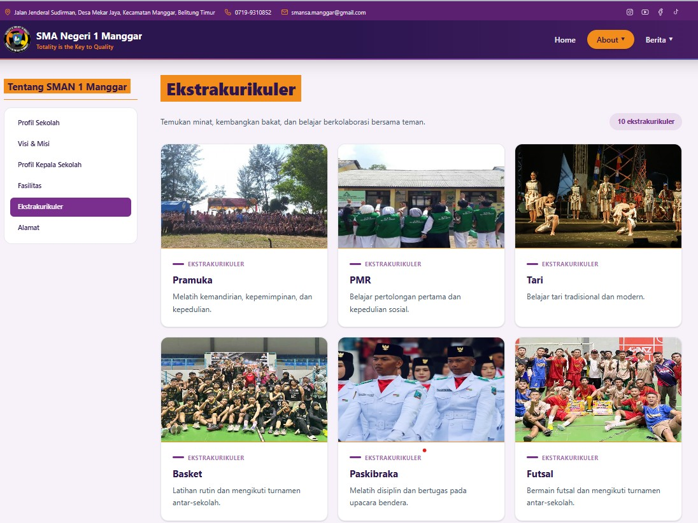
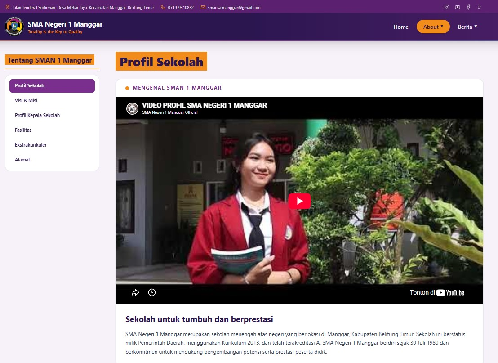
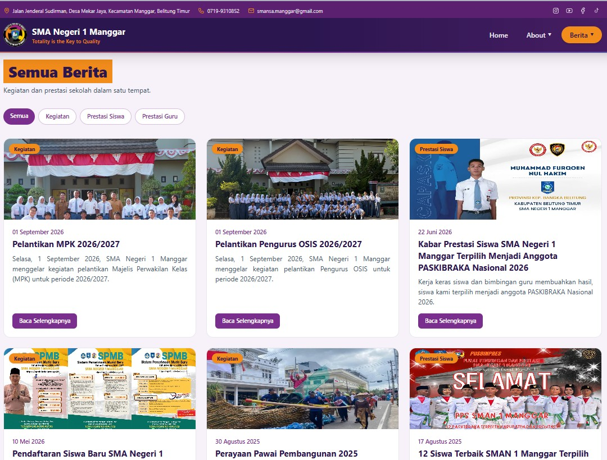

# Proyek Website Sekolah & Ekstrakurikuler

Website ini dibangun menggunakan kerangka kerja Next.js untuk mengelola dan menampilkan informasi terkait kegiatan ekstrakurikuler sekolah, seperti Futsal, Basket, Paskibra, Tari, Jurnalistik, Paduan Suara, dan lainnya.

## 🚀 Fitur Utama

*   **Profil Ekstrakurikuler:** Menampilkan daftar dan informasi detail mengenai setiap kegiatan ekstrakurikuler yang tersedia.
*   **Galeri Kegiatan:** Visualisasi aktivitas siswa melalui foto-foto kegiatan.
*   **Desain Responsif:** Tampilan yang dioptimalkan untuk perangkat mobile maupun desktop.

## 🛠️ Teknologi yang Digunakan

*   [Next.js](https://nextjs.org/) - Framework React
*   [Tailwind CSS](https://tailwindcss.com/) - (Berdasarkan konfigurasi postcss umumnya) Framework CSS untuk styling
*   JavaScript/TypeScript

## 📸 Tampilan Antarmuka (Screenshots)


### Beranda


### Section Ekstrakurikuler


## Profil Sekolah


### Detail Berita / Informasi Tambahan


## 💻 Cara Menjalankan Proyek Secara Lokal

Ikuti langkah-langkah berikut untuk menjalankan proyek ini di komputer Anda:

1.  **Clone repositori ini:**
    ```bash
    git clone <url-repositori-anda>
    ```

2.  **Masuk ke direktori proyek:**
    ```bash
    cd uts
    ```

3.  **Instal dependensi:**
    ```bash
    npm install
    # atau
    yarn install
    # atau
    pnpm install
    ```

4.  **Jalankan server pengembangan:**
    ```bash
    npm run dev
    # atau
    yarn dev
    # atau
    pnpm dev
    ```

5.  Buka [http://localhost:3000](http://localhost:3000) di browser Anda untuk melihat hasilnya.

## 📁 Struktur Direktori Utama

*   `public/ekskul/` - Berisi aset gambar untuk berbagai kegiatan ekstrakurikuler.
*   `public/slides/` - Berisi aset gambar untuk slider/carousel berita atau banner.

---
*Dibuat untuk tugas/proyek UTS.*